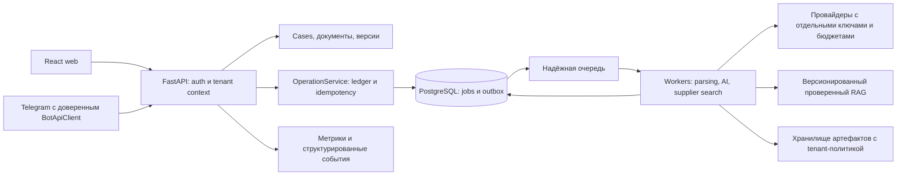

# Аудит Tendr — 13 октября 2026

## Вердикт

У проекта есть работающий каркас и полезные защитные механизмы, но текущую версию
нельзя считать готовой к платному многопользовательскому production.
Основные препятствия — изоляция данных компаний, учёт расходов, надёжность фоновых
операций и ошибки production-healthcheck. Увеличение числа функций сейчас усилит
эти проблемы. Переписывать весь проект или менять язык/фреймворк для их исправления не требуется.

Аудируется `amirlan-io/tendr` на базе `0d37db9` с локальными изменениями интеграции
`tendr-fixed.zip`. Код PR №3 друга уже включён в эту базу. Backend и fullstack
рассматриваются как один продукт: сервер, веб, Telegram, задания, БД, AI/RAG,
поставщики, документы, тарифы и эксплуатация.

Это аудит и рекомендации. Во время аудита исходники приложения не исправлялись.
Предыдущие локальные изменения сохранены. Отчёт не означает публикацию или деплой.

## Доказательства и границы проверки

| Проверка | Результат |
|---|---|
| Backend `pytest -q` | 543 passed, 13 предупреждений |
| Frontend `npm test -- --run` | 114 passed |
| TypeScript и production-сборка | Успешно |
| Адресные API/БД-пробы | Подтверждены перечисленные ниже дефекты |
| Проба локального состояния frontend | Подтверждено наследование избранного предыдущего аккаунта |
| Qdrant `v1.15.5` из production Compose | В образе отсутствует `wget`; также отсутствует `curl` |
| `npm audit` | 18 затронутых пакетов/цепочек: 16 high, 2 moderate; **3 уникальных advisory** |
| `pip-audit` | Проверены записи 90 зависимостей; **6 уникальных advisory у локального pip 25.0.1** |

657 существующих тестов прошли. Они не обнаружили ошибки, воспроизведённые
специальными пробами аудита. Это показывает пробелы покрытия, а не готовность production.
Повторяющиеся записи advisory Python дедуплицированы по ID; локальные пакеты
`tendr-backend` и `tendr-bot` не проверяются по базе PyPI и исследованы по исходникам.
Уязвимость инструмента pip не следует выдавать за доказанную удалённую уязвимость API.

Пробы используют изолированные SQLite/Qdrant, фиктивных пользователей и локальные
заглушки провайдеров. Реальные письма, звонки, платежи и платные AI-вызовы не выполнялись.
Реальные Supabase-сессии, Госзакупки, качество LLM на корпусе закупок, нагрузка на
production и визуальная проверка в полноценном браузере не подтверждены этим аудитом.
В текущей машине внешние AI-сервисы и юридический индекс не готовы; это отдельное
ограничение конфигурации, а не доказательство поломки всех интеграций.

Сырые результаты и скрипты воспроизведения находятся в `/workspace/tendr-cloud/audit/`:
`evidence-summary.json`, `probes.py`, `business_probes.py`, `tenant_quota_probes.py`,
`data_probes.py`, `frontend-probe.log`, логи тестов и JSON отчётов зависимостей.
Временный тест frontend удалён после выполнения.

Приоритеты: **P0** — устранить до доступа независимых компаний или платного пилота;
**P1** — устранить до надёжной эксплуатации соответствующей функции;
**P2** — плановое улучшение качества, поддержки и расширения.
Статусы: **В** — воспроизведено; **К** — установлено по коду; **Р** — риск,
для измерения которого нужна эксплуатационная или интеграционная проверка.

## Находки P0

### A01. B2G использует частные анализы других пользователей — В

Источник: [b2g.py](/workspace/tendr/backend/app/api/b2g.py:264).
Запрос похожих анализов фильтрует `Analysis` по названию и бюджету, но не по владельцу.
Полученные название, бюджет и заказчик передаются в `B2GRequest.similar_lots`.
В пробе запрос пользователя B передал агенту данные частного анализа пользователя A.
Это касается и загруженных документов, а не только публичных карточек закупок.

**Исправить:** отделить публичный каталог `Lot` от пользовательских `Analysis`.
Для частных данных применять фильтр владельца/разрешённой организации на уровне
репозитория. Общие примеры брать из публичного каталога или явно разрешённого
обезличенного набора. Не ограничиваться проверкой доступа к B2G-workspace.

**Приёмка:** два независимых пользователя и два workspace; ни API-ответ, ни
контекст фиктивного LLM, ни документы B не содержат данные A.

### A02. Браузерное состояние не изолировано по аккаунтам — В/К

Источники: [dashboard.data.ts](/workspace/tendr/web/src/dashboard/dashboard.data.ts:67),
[Analyze.tsx](/workspace/tendr/web/src/pages/Analyze.tsx:394),
[AuthContext.tsx](/workspace/tendr/web/src/auth/AuthContext.tsx:55).
Избранное, документы, история и чаты используют общие ключи localStorage.
При отсутствии состояния на сервере `hydrateCabinetFromServer()` подставляет
локальные данные прошлого аккаунта. Logout не очищает и не переключает эти хранилища.
Проба подтвердила наследование избранного новым аккаунтом. Для чатов код также
синхронизирует локальные сессии в текущий серверный workspace; их перенос в чужой
аккаунт — дополнительный риск, отдельный полный браузерный сценарий ещё нужен.

**Исправить:** namespace всех пользовательских ключей по подтверждённому `user.id`,
сброс состояния React при смене identity, запрет синхронизации до завершения
гидратации именно этого аккаунта. `null` нового аккаунта означает пустой workspace,
а не разрешение импортировать общий кэш. Миграция старого кэша — только явная.

**Приёмка:** A → logout → B, пустой серверный workspace, offline, две вкладки,
refresh токена. Ни одна комбинация не показывает или не отправляет данные A за B.

### A03. Гостевой AI-поиск и незавершённое списание квоты — В/К

Источник: [lots.py](/workspace/tendr/backend/app/api/lots.py:354).
Каталог использует `require_client_id`, принимающий гостевую идентичность.
Та же ручка разрешает `with_ai=true`. Контрольная проба без Bearer вернула 200.
Успешный путь резервирует квоту, но не вызывает `confirm_user_quota`.
При транзакции, аналогичной реальному сохранению каталога, резерв остаётся `reserved`;
его TTL — 900 секунд. После истечения резерв не превращается в оплату выполненной работы.

**Исправить:** публичный поиск каталога и авторизованный AI-анализ разделить.
Выполнить общий цикл `reserve → execute → confirm/release`. Учитывать фактически
обработанные лоты, кэш и пустую выдачу, а не только запрошенный `ai_limit`.

**Приёмка:** гость читает каталог, но не запускает платную модель; успешный AI-запуск
остаётся в ledger после TTL; ошибка и нулевая фактическая работа не удерживают резерв.

### A04. Внешние расходы не проходят через единый ledger — К/частично В

Источники: [products.py](/workspace/tendr/backend/app/api/products.py:23),
[suppliers.py](/workspace/tendr/backend/app/api/suppliers.py:130),
[b2g.py](/workspace/tendr/backend/app/api/b2g.py:279).
Поиск товаров/поставщиков и генерация B2G требуют авторизацию, но в этих маршрутах
нет общего резервирования и подтверждения кредитов. Проба `/products/search`
вернула 200 с нулём вызовов резервирования. Наличие IP/token rate limit не задаёт
месячный тариф и не ограничивает общий финансовый расход аккаунта.

**Добавить:** общий `OperationService` с кодом операции, пользовательской ценой,
максимальным расходом провайдера и обязательной идемпотентностью. Определить, какие
операции включены бесплатно, какие списывают кредиты и каковы их отдельные бюджеты.
Проверять лимит до внешнего запроса и фиксировать реальный usage после него.

**Приёмка:** исчерпанный лимит блокирует все тарифицируемые пути, включая прямые
API-вызовы; нет обхода через B2G, sandbox, product search, browser или AI-чат.

## Backend: надёжность, документы и интеграции

### A05. Одно одобрение позволяет повторную отправку — P1, В

Источники: [outreach.py](/workspace/tendr/backend/app/services/outreach.py:287),
[models.py](/workspace/tendr/backend/app/db/models.py:622).
Одобрение проверяется на `approved`, затем создаётся новый job. После отправки
оно остаётся `approved`; уникального ограничения на исполнение одобрения нет.
В пробе два последовательных вызова вызвали фиктивный email-провайдер дважды.

**Исправить:** атомарный переход approval `approved → executing → executed`,
один execution на approval, уникальный ключ операции и идемпотентность у провайдера,
когда он её поддерживает. Для SMTP определить поведение при неизвестном результате
отправки; обещать строгую exactly-once доставку без поддержки провайдера нельзя.
Сохранять исходную редакцию текста, адресата и решение пользователя.

**Приёмка:** двойной клик, повтор POST и два параллельных запроса не создают второе
письмо/звонок; сбой после принятия провайдером попадает в reconciliation, а не в слепой retry.

### A06. Запуск API сбрасывает работающие задания — P1, В

Источник: [analysis_jobs.py](/workspace/tendr/backend/app/services/analysis_jobs.py:64).
`recover_analysis_jobs` переводит все `running` в `queued` без lease/heartbeat.
Его вызывает startup каждого процесса API; production запускает два API-worker.
Проба подтвердила повторное помещение активного задания в очередь.
Атомарный claim `queued → running` полезен, но не защищает от последующего сброса
состояния другим процессом. Повторные платные вызовы и конфликты результата — риски.

**Исправить:** `worker_id`, `lease_until`, heartbeat, recovery только просроченных
lease одним координатором. Фиксировать результаты этапов и ключ внешней операции.

### A07. Очередь не имеет подтверждения обработки — P1, К

Источники: [analysis.py](/workspace/tendr/backend/app/workers/analysis.py:26),
[docker-compose.prod.yml](/workspace/tendr/infra/docker-compose.prod.yml:38).
`BLPOP` удаляет сообщение до окончания обработки. При SIGKILL не выполняется
ветка возврата сообщения. Worker сам не выполняет периодический recovery.
Redis также хранит очереди вместе с лимитами при `allkeys-lru`: очередь может
быть вытеснена. Строка задания в PostgreSQL остаётся, но запуск до следующего
recovery API не гарантирован.

**Исправить:** Redis Streams с consumer groups/claim либо зрелая библиотека очередей
с acknowledgment и visibility timeout. PostgreSQL остаётся источником истины.
Долговечную очередь отделить от вытесняемого кэша; добавить dead-letter и retries с backoff.

### A08. Polling сам исчерпывает rate limit — P1, В

Источники: [Analyze.tsx](/workspace/tendr/web/src/pages/Analyze.tsx:524),
[rate_limit.py](/workspace/tendr/backend/app/core/rate_limit.py:36).
Статус запрашивается каждые 1,5 секунды: около 40 запросов в минуту.
Лимит на весь префикс `/analysis-jobs` — 30/минуту, включая GET.
Проба: 30-й запрос 200, 31-й — 429. Клиент проглатывает ошибку и продолжает polling.

**Исправить:** отдельные лимиты на создание/чтение задания, учитывать `Retry-After`,
backoff, одну активную цепочку запросов. SSE можно добавить позже; корректный polling
достаточен для MVP. Тот же limiter не должен блокировать quota/состояние операции.

### A09. Rate limit привязан к сырому токену — P1, К

Источник: [rate_limit.py](/workspace/tendr/backend/app/core/rate_limit.py:69).
Ключ вычисляется из Bearer до проверки его валидности и меняется вместе с токеном.
Это позволяет обходить предавторизационный лимит сменой заголовка; авторизацию
и доступ к чужим данным такая смена сама по себе не предоставляет.

**Исправить:** два уровня: лимит по реальному адресу до auth и по проверенному subject
после auth. Настроить доверенные reverse proxy; не доверять произвольному X-Forwarded-For.

### A10. Неуспешный результат может считаться выполненной платной задачей — P1, К

Источник: [analysis_jobs.py](/workspace/tendr/backend/app/services/analysis_jobs.py:193).
Любой возвращённый `LotAnalysisResponse` подтверждает резерв и получает `completed`,
включая `incomplete=True`. Оркестратор возвращает такой результат и для ненайденного
лота. Исключения освобождают кредит, а обычный ответ о невозможности анализа — нет.

**Исправить:** разделить success/partial/unavailable/not_found; определить публичную
политику оплаты частичного результата. Ненайденный лот и отсутствие анализа не
должны тарифицироваться как успешный разбор. Полезные исходные данные сохранять отдельно.

### A11. Админский сброс квоты уничтожает историю и не сбрасывает использование — P1, В

Источники: [account.py](/workspace/tendr/backend/app/api/account.py:693),
[repo.py](/workspace/tendr/backend/app/db/repo.py:390).
Админский endpoint удаляет `Analysis`, но не корректирует подтверждённые резервы.
В пробе история стала пустой, а `quota.used` остался 1.

**Убрать/заменить:** удалить destructive reset из production либо заменить
отдельной административной корректировкой ledger с причиной, автором и журналом.
Не использовать удаление результатов как финансовую операцию.

### A12. Telegram-канал несовместим с текущим API — P1, В/К

Источники: [analyze.py](/workspace/tendr/bot/bot/handlers/analyze.py:132),
[discover.py](/workspace/tendr/bot/bot/handlers/discover.py:39).
Бот передаёт `X-Client-Id: tg:<id>`, а платные маршруты требуют Supabase Bearer.
Прямой запрос в пробе получил 401. Discovery, search, verify и subscribe используют
старые адреса без `/api`; проверенный discovery-адрес вернул 404.
В анализе обрабатывается 402, тогда как текущая квота возвращает 429.

**Исправить:** единый BotApiClient, доверенная серверная аутентификация бота,
привязка Telegram к аккаунту, явная защита от подмены Telegram ID, актуальные маршруты
и обработка ошибок. Удалить устаревшие fallback-комментарии и ответы с сырым `resp.text`.
Добавить контрактные тесты всех команд и сохранение языка в FSM.

### A13. НДС в заявке DOCX вычисляется неверно — P1, В

Источник: [application_generator.py](/workspace/tendr/backend/app/agents/application_generator.py:117).
При надписи «в том числе НДС» используется `price × rate / 100`.
Для 112 000 и 12% документ содержит 13 440, тогда как включённый НДС равен
`112000 × 12 / 112 = 12000`.

**Исправить:** единая финансовая модель `net/gross/vat`, Decimal, правила округления,
признак плательщика НДС и ставка с датой действия. Проверить согласованность заявки,
калькулятора и supplier quote. Значение 12% в defaults отдельно сверить с действующим
законодательством и налоговым режимом; этот аудит не подтверждает актуальность ставки.

### A14. Vision-fallback может отправить ключ другого провайдера в Mistral — P1, К

Источник: [vision.py](/workspace/tendr/backend/app/services/vision.py:90).
Fallback создаёт Mistral с `settings.llm_api_key` независимо от `llm_provider`.
Если основной провайдер Alem/OpenAI-compatible, используется его ключ.
Отдельный OCR-ключ эту ветку не исправляет.

**Исправить:** отдельные bindings `chat/embedding/ocr/vision` с destination и provider,
никакого повторного использования чужого ключа. Проверить маршрут с фиктивными ключами
и захватом constructor/headers; реальные ключи не выводить и не передавать для проверки.

### A15. Browser-сессии хранятся в памяти одного API-worker — P1, К

Источник: [browser_actions.py](/workspace/tendr/backend/app/api/browser_actions.py:47).
Сессии и activity-лимиты — словари процесса, а production API запускается с двумя workers.
Последующий status/continue может попасть в процесс, не знающий сессию.
Рестарт теряет привязку; лимит параллельных задач также не общий.

**Исправить:** серверная запись сессии с владельцем и TTL в БД/Redis, общий semaphore,
job-модель для длительных задач. Сохранять существующие шаблоны и allowlist доменов.

### A16. Новый API-job может быть сохранён, но не поставлен в очередь — P1, К

Источник: [lots.py](/workspace/tendr/backend/app/api/lots.py:950).
Commit строки и резерва происходит перед `schedule_analysis_job`.
Если Redis недоступен между ними, клиент получает ошибку, а строка/резерв остаются.
Повтор клиентом создаёт новую операцию, поскольку Idempotency-Key отсутствует.

**Добавить:** transactional outbox, уникальный client operation ID, reconciler для
queued-but-not-enqueued, безопасное возвращение существующего задания при повторе POST.

## AI, RAG и достоверность

### A17. Переиндексация оставляет устаревшие фрагменты закона — P1, В

Источники: [store.py](/workspace/tendr/backend/app/rag/store.py:187),
[indexer.py](/workspace/tendr/backend/app/rag/indexer.py:46).
Upsert обновляет существующие ID, но не удаляет исчезнувшие chunks.
Проба: два абзаца → новая версия с одним абзацем; в коллекции остаются два,
включая устаревший. Проверка возраста всего корпуса не удаляет такой источник.

**Исправить:** версия документа и корпуса, hash источника, новая immutable коллекция
с alias swap после полной проверки; либо атомарное обновление по source/version с
удалением старых chunks. Прямую смену старых integer-ID на UUID тоже сопровождать
планом миграции — иначе старые точки остаются рядом с новыми.

### A18. Юридический агент не читает весь длинный документ — P1, К

Источник: [legal.py](/workspace/tendr/backend/app/agents/legal.py:143).
В LLM передаются первые 10 000 символов ТЗ; запрос поиска норм использует первые 500,
нормативный контекст ограничен 4 000 символами. Documenter читает текст частями,
поэтому полнота этих двух анализов расходится.

**Добавить:** юридическую проверку по разделам с перечнем coverage, приоритетом
обязательных требований и объединением результатов. Показывать нерассмотренные разделы.
Тестовый риск только в середине/конце длинного ТЗ должен быть обнаружен либо явно
помечен как непроверенный, но не скрыт общим итогом.

### A19. Достоверная цитата не доказывает правовой вывод — P1, К/Р

Источник: [legal.py](/workspace/tendr/backend/app/agents/legal.py:169).
Цитата, URL и редакция проверяются, но смысловой вывод, номер статьи,
severity и overall risk приходят от модели. Цитата может быть настоящей,
а её применение к конкретной закупке — ошибочным.

**Добавить:** ID нормы, её область применения, фактическое основание из ТЗ,
проверку связки «факт → норма → вывод», реестр утверждений и причины неопределённости.
Для критичных решений нужен экспертный контроль по официальным первоисточникам.
Не выводить юридическую гарантию из наличия RAG и не создавать автоматически жалобу.

### A20. B2G обходит новую политику актуальности юридического корпуса — P1, К

Источник: [b2g.py](/workspace/tendr/backend/app/agents/b2g.py:126).
Этот агент использует RAG напрямую и содержит захардкоженный запрос о статьях 9–15.
Проверки `LEGAL_CORPUS_VERIFIED`, возраста и проверенных source metadata,
которые есть в LegalAgent, здесь не общие.

**Исправить:** единый `VerifiedLegalContextService`; все агенты и генераторы документов
получают нормы только через него. Удалить неподтверждённые фиксированные номера статей.

### A21. Успешная часть Documenter маскирует провал остальных разделов — P1, К

Источники: [documenter.py](/workspace/tendr/backend/app/agents/documenter.py:75),
[orchestrator.py](/workspace/tendr/backend/app/services/orchestrator.py:341).
При пустом JSON раздел пропускается с warning. Если другой раздел успешно разобран,
общий `incomplete` не учитывает такой пропуск. Сверка цитат защищает от выдуманных
требований, но не обнаруживает отсутствующие требования.

**Добавить:** структурированный статус каждого раздела, общий coverage, повтор только
сбойных разделов и видимый partial. Тестировать полноту и precision отдельно.

### A22. Скоринг заказчика и маржа не имеют достаточной эмпирической основы — P2, К/Р

Источник: [scoring.py](/workspace/tendr/backend/app/services/scoring.py:99).
Trust вычисляется по внутренним анализам с поиском по части имени и бонусом за
число анализов; это не история оплаты заказчиком. Маржа — таблица по категориям,
а не закупочная цена конкретного клиента. Дисклеймеры уже есть и их нужно сохранить.

**Убрать из решающих критериев:** label `trusted` и оценку вероятности успеха на
основании просмотров/AI-risk. Идентифицировать заказчика по БИН. Фактическую маржу
считать по подтверждённой цене, количеству, налогам, логистике и резерву риска.
Экспериментальный score показывать отдельно с источниками, выборкой и calibration.

### A23. Нет подтверждённого quality gate для AI — P1, Р

Тесты с заглушками проверяют программную логику, но не качество настоящих моделей.
Нужен версионированный набор реальных/разрешённых обезличенных ТЗ с разметкой эксперта:
позиции, количество, единицы, документы, сроки, источники и юридические ограничения.

**Добавить:** offline evaluation до смены prompt/model/corpus; полнота извлечения,
доля неподтверждённых утверждений, ошибки числа/валюты/единицы, стоимость и время.
Порог выпуска определить по измерениям пилота, а не произвольному «95% точности».

## Fullstack: контракты, состояние и пользовательский опыт

### A24. API-типы поддерживаются вручную — P2, К

Backend Pydantic, структуры страниц, `dashboard.types.ts` и `suppliers.types.ts`
развиваются отдельно. Уже есть несовместимый Telegram-клиент; новые поля вроде
`source_section` тоже требуют согласованного представления.

**Добавить:** generated TypeScript types/client из OpenAPI, CI-проверку diff контракта,
один API-слой, устойчивые коды ошибок и contract tests для web/bot. Runtime validation
нужна на границе сохранённого workspace и внешних данных, а не только TypeScript cast.

### A25. Раздел документов скрывает отчёты загруженных файлов — P1, К

Источник: [Documents.tsx](/workspace/tendr/web/src/dashboard/pages/Documents.tsx:27).
Раздел фильтрует историю по числовому `lot_id`. Загрузки теперь получают
`uploaded-<uuid>` и в эту выдачу не попадают. Кнопка в Analyze может работать через
свой путь, но единый кабинет документов не охватывает эти результаты.

**Исправить:** документы адресовать по `analysis_id`/`job_id`, а не по числовому ID лота.
Хранить artifact metadata и версии. Пользователь должен повторно скачать свой отчёт
после refresh, входа с другого устройства и из списка документов.

### A26. Три хранилища профиля компании расходятся — P2, К

Источники: [useProfile.ts](/workspace/tendr/web/src/dashboard/hooks/useProfile.ts:87),
[account.py](/workspace/tendr/backend/app/api/account.py:102),
[models.py](/workspace/tendr/backend/app/db/models.py:511).
Settings обновляет Supabase metadata; backend имеет `User.company_name` и отдельный
`CompanyProfile` с контактами исходящих сообщений. Одно обновление не синхронизирует
автоматически все три модели.

**Исправить:** Supabase отвечает за identity, CompanyProfile — за бизнес-профиль.
Один endpoint сохранения, явные роли и разделение личного email/work email.
Изменение профиля не должно незаметно менять уже одобренный текст письма.

### A27. Ошибки синхронизации и долгих запросов часто скрываются — P2, К

Источники: [workspaceState.ts](/workspace/tendr/web/src/workspaceState.ts:16),
[dashboard.data.ts](/workspace/tendr/web/src/dashboard/dashboard.data.ts:93),
[clientId.ts](/workspace/tendr/web/src/clientId.ts:285).
Workspace PUT выполняется без видимого состояния синхронизации и контроля версии.
Несколько вкладок пишут последний полный JSON; конфликты last-write-wins не разрешены.
Обычные fetch не задают общий deadline; polling использует interval и может перекрывать запросы.

**Добавить:** dirty/saving/saved/offline/error, debounce, AbortController, backoff,
ETag/revision optimistic concurrency, узкие обновления вместо постоянного полного снимка.
TanStack Query — разумный кандидат, но можно сначала сделать небольшой общий слой.

### A28. Политика тарифов и видимая квота расходятся с реализацией — P2, К

Источники: [Billing.tsx](/workspace/tendr/web/src/dashboard/pages/Billing.tsx:58),
[dashboard.data.ts](/workspace/tendr/web/src/dashboard/dashboard.data.ts:24),
[repo.py](/workspace/tendr/backend/app/db/repo.py:519).
Billing считает остаток `limit-used` без активных резервов. Фактический backend
учитывает резервы и пятичасовое окно. Тарифы повторены в нескольких frontend/backend
таблицах. Формулировка о расчётном периоде не описывает фактический календарный месяц UTC.

**Исправить:** backend отдаёт единую публичную структуру тарифов и остаток с резервами,
временной зоной и next reset. UI не пересчитывает бизнес-правила. Обещание приоритетной
обработки должно опираться на приоритетную очередь, которой сейчас не видно в worker.

### A29. Ошибки auth и интерфейса требуют отдельного покрытия — P2, К/Р

Источник: [AuthContext.tsx](/workspace/tendr/web/src/auth/AuthContext.tsx:32).
Начальная `getSession()` не имеет catch для отклонённого Promise. ErrorBoundary
для React-дерева в просмотренной точке входа не зарегистрирован. Не подтверждены
реальная навигация с auth, загрузка, refresh и мобильный пользовательский путь.

**Добавить:** управляемое auth error state, ErrorBoundary, browser E2E, тесты
клавиатуры/фокуса и reduced-motion, mobile/tablet QA, проверку русской/казахской
локализации именно новых кабинетов. Исправлять по обнаруженным браузерным дефектам,
не объявлять визуальный дизайн сломанным по одному статическому анализу.

## Эксплуатация, безопасность поставки и сопровождение

### A30. Qdrant healthcheck не может выполниться — P1, В

Источник: [docker-compose.prod.yml](/workspace/tendr/infra/docker-compose.prod.yml:55).
Образ `qdrant/qdrant:v1.15.5` не содержит `wget`, используемый healthcheck.
Текущий dev-контейнер тоже имеет status `unhealthy` при работающем HTTP-сервисе.
Production API зависит от `qdrant: service_healthy`, поэтому этот дефект блокирует startup.

**Исправить:** поддерживаемый проверенный probe/образ; не отключать проверку просто
ради зелёного статуса. CI должен запускать точный production Compose и дождаться healthy.

### A31. Production healthcheck API получает 400 — P1, В

Источники: [main.py](/workspace/tendr/backend/app/main.py:138),
[docker-compose.prod.yml](/workspace/tendr/infra/docker-compose.prod.yml:95).
Production не разрешает localhost в `ALLOWED_HOSTS`, но curl в healthcheck отправляет
Host localhost. Проба: localhost → 400, разрешённый домен → 200.

**Исправить:** отправлять конкретный разрешённый Host в probe либо отдельно спроектировать
внутренний health endpoint. Не обходить TrustedHost wildcard-значением.

### A32. Health может сам вызывать платную модель — P1, К

Источники: [health.py](/workspace/tendr/backend/app/api/health.py:107),
[base.py](/workspace/tendr/backend/app/llm/base.py:64).
Открытые health/health-llm выполняют inference/embedding healthcheck; они не входят
в текущий limiter. Liveness уже отделён правильно и не вызывает провайдеров.

**Исправить:** кешированный readiness из фоновых проверок, auth для подробной
диагностики, метрики состояния worker/Redis/очереди/БД. Публичный мониторинг не должен
запускать платную работу на каждый запрос. Отдельно исправить FailoverProvider.healthcheck:
при обычном `False` primary secondary не проверяется, хотя чат fallback может работать.

### A33. Зависимости имеют актуальные предупреждения и плавающую установку — P1/P2, В/К

`npm audit` сообщает три уникальные проблемы:

- [braces / GHSA-vfj7-8cjw-p6xm](https://github.com/advisories/GHSA-vfj7-8cjw-p6xm): stack-exhaustion DoS.
- [source-map-js / GHSA-68fv-2mgg-jv7q](https://github.com/advisories/GHSA-68fv-2mgg-jv7q): event-loop DoS.
- [postcss-selector-parser / GHSA-rj75-hqrm-r3gf](https://github.com/advisories/GHSA-rj75-hqrm-r3gf): CPU exhaustion.

18 — число затронутых пакетов и транзитивных цепочек, не 18 независимых дыр.
Большая часть касается tooling сборки; удалённая эксплуатация production-сайта
не установлена. `fixAvailable=false` запрещает считать слепой `npm audit fix` решением.
Python manifest использует широкие нижние границы без lock; текущий client Qdrant
1.19.1 и production server 1.15.5 дополнительно требуют проверки совместимости.
Локальный pip 25.0.1 имеет шесть уникальных advisory; это отдельная проблема инструмента установки.

**Исправить:** обновить подтверждённые зависимости через отдельный PR с тестами,
закрепить Python resolution/хеши, сверить client/server Qdrant, добавить SCA и SBOM
в CI. Не отключать signature/checksum/TLS и не обновлять вслепую до другого major.

### A34. Недостаточно проверен production-контур — P1/P2, К/Р

Источники: [Dockerfile](/workspace/tendr/backend/Dockerfile:1),
[docker-compose.prod.yml](/workspace/tendr/infra/docker-compose.prod.yml:80),
[ci.yml](/workspace/tendr/.github/workflows/ci.yml:72).
Backend-образ работает без отдельного USER; базовый образ и Python resolution плавают.
В корне отсутствует `.dockerignore`. Compose не содержит frontend-serving/TLS-контур,
API публикуется на всех интерфейсах. Это может быть дополнено внешним reverse proxy,
но такой контур этим аудитом не проверен. CI проверяет тесты/сборку/чистые миграции,
но не exact production Compose, graceful shutdown и миграцию с предыдущей БД.

**Добавить:** non-root image, минимальный build context, согласованный reverse proxy,
TLS, limits/requests, health/readiness, CI smoke Compose, upgrade migration test,
проверенный backup/restore и инструкции отката с допустимостью схемы.

### A35. Телеметрия и хранение данных не соответствуют масштабу продукта — P2, К/Р

Источники: [errors.py](/workspace/tendr/backend/app/api/errors.py:42),
[error_reporter.py](/workspace/tendr/backend/app/services/error_reporter.py:118).
Публичные отчёты ошибок используют общий процессный бюджет уведомлений.
Отдельного предавторизационного limiter на `/api/errors` нет: синтетические ошибки
могут заполнить бюджет настоящих уведомлений. У reviewed code нет законченного
workflow удаления аккаунта, retention документов/чатов, выгрузки данных и фоновой
очистки оставшихся файлов; отсутствие записи в БД не равно удалению артефактов.

**Добавить:** request/operation/tenant correlation IDs, метрики по этапам и стоимости,
очередь/возраст pending/heartbeat, безопасные structured logs, redaction по allowlist,
контроль размера тела до полного parsing, retention и удаление всех tenant artifacts.
Для браузерных записей, документов и передачи поставщикам/AI нужен ясный пользовательский режим согласия.

### A36. Не объявлены SDK для работающих пользовательских функций — P1, В/К

Источники: [supplier_agent.py](/workspace/tendr/backend/app/agents/supplier_agent.py:881),
[client.py](/workspace/tendr/backend/app/agents/browser_use/client.py:75),
[pyproject.toml](/workspace/tendr/backend/pyproject.toml:12).
В текущей установленной среде отсутствуют модули `tavily` и `browser_use_sdk`.
В manifest backend нет `tavily-python` и `browser-use-sdk`, хотя сервер импортирует
их для поиска поставщиков/товаров и Browser Use v3. Добавление ключа не устанавливает SDK:
Tavily init перехватывает ImportError, оставляет client=None, поиск поставщиков
далее отвечает `SEARCH_PROVIDER_NOT_CONFIGURED`. REST-клиент Browser Use v4 — отдельный
путь и не исправляет отсутствующую v3-зависимость.

**Добавить:** объявленные и проверенные runtime-dependencies либо явные extras для
отключаемых функций. Capability endpoint должен учитывать не только наличие ключа,
но и готовность клиента. CI smoke свежего install обязан импортировать реальные
адаптеры; внешние запросы для этого не нужны.

### A37. Синхронные сетевые/парсинговые операции остаются внутри async API — P1/P2, К/Р

Источники: [store.py](/workspace/tendr/backend/app/rag/store.py:207),
[document_reader.py](/workspace/tendr/backend/app/services/document_reader.py:203).
Qdrant используется через синхронный клиент; его ensure/upsert/query выполняются
в async-функциях без offload. PDF/DOCX уже вынесены в thread, но Excel-parsing
остаётся синхронным в async-обёртке. Лимит размера результата не задаёт CPU/RAM
декомпрессии входного документа. Реальная задержка под нагрузкой ещё не измерена.

**Исправить:** AsyncQdrantClient либо контролируемый thread offload, выделенные
парсинговые workers/processes с таймаутом и ресурсными пределами, bounded concurrency.
Проверять latency обычного liveness/статуса во время большого чтения и медленного Qdrant.

## Что оставить

- React + TypeScript + Vite, FastAPI + Pydantic, PostgreSQL + Alembic: смена стека не решает найденные ошибки.
- Проверку Supabase-сессии и привязку действий к владельцу. Переносить её в клиент нельзя.
- Ограничение официальных URL/вложений и SSRF-guard с fail-closed DNS. Не снимать guard ради доступности сайтов.
- Связку требований с цитатами и источниками, честные `unknown/needs_review`, полный сохранённый результат.
- Серверные одобрения исходящих действий. Усилить их однократным исполнением и журналом.
- Durable job rows, конкурентное резервирование через блокировку пользователя, подпись Stripe webhook.
- Предварительную проверку неподтверждённых условий; не возвращать ложный «успех» после исключения.
- Существующие тесты и замороженный frontend lockfile; добавить недостающие жизненные сценарии.

## Что убрать, скрыть или отложить

| Элемент | Решение | Причина |
|---|---|---|
| Автоматические юридические жалобы | Оставить выключенными | Нужны подтверждённые нормы, актуальная процедура и профессиональная проверка |
| destructive reset quota | Убрать из production | Уничтожает результаты и не исправляет ledger |
| Числовой trust без объективных данных | Убрать из решающих рекомендаций | Число анализов не доказывает платёжную надёжность |
| Маржа «по категории» в роли фактической прибыли | Перевести в необязательный ориентир | Нет реальной себестоимости клиента |
| Демо fallback каталога | Только явный dev-флаг | Отсутствие доступа должно означать unavailable, а не фиктивные реальные лоты |
| Старые API-пути и файловые fallback бота | Удалить после BotApiClient | Маскируют несовместимость и создают два контракта |
| Process-local browser state | Заменить общей моделью | Не работает надёжно с несколькими workers |
| B2G и sandbox в основном MVP-меню | Временно закрыть feature flag до исправлений | Расширяют scope, расходы и риск смешения данных |
| Три источника тарифов/профилей | Объединить | Данные и бизнес-правила расходятся |
| Dev UI preview и mock navigation в production | Скрыть/исключить из production-router | Пользовательские потоки не должны вести в демонстрационные интерфейсы |
| Продажа «приоритетной обработки» без очереди приоритетов | Убрать обещание до реализации | Простой BLPOP не разделяет тарифы |
| Переписывание в микросервисы/другой frontend | Отложить | Сейчас важнее границы доступа, контракты и надёжность операций |

## Что добавить в основной продукт

1. **Рабочее пространство закупки:** один `tender case` с исходником, snapshot,
   требованиями, документами, ценами, решением и журналом. Анализы становятся его
   версиями; разные загрузки не теряются и разные компании не смешиваются.
2. **Матрицу соответствия:** требование → источник/страница → подтверждение
   поставщика → unknown/partial/fits/no → ответственный → срок. Отдельно отмечать
   обязательность, вывод модели и подтверждение человека.
3. **Пакет документов:** чек-лист, шаблоны, версия результата, обязательные поля,
   статус готовности, экспорт с источниками. Непроверенный юридический текст не
   маркировать готовым документом для подачи.
4. **Настоящую финансовую модель:** поставщик/товар/количество/валюта/курс/НДС/
   доставка/срок цены/резерв риска, сопоставимость предложений и сценарии маржи.
5. **Зафиксированные предложения поставщиков:** date checked, quantity/unit,
   источник цены и срока, история редакций; отделить цену из поиска от коммерческого предложения.
6. **Календарь дедлайнов:** часовой пояс закупки, дата обновления, источник,
   напоминания и явное подтверждение изменения срока. Не полагаться на старый localStorage-кэш.
7. **Tenant/organization-модель:** участники, роли, приглашения, права на case,
   журнал действий; личный аккаунт и компания — разные сущности.
8. **Usage и стоимость:** пользователь видит цену операции до запуска,
   резерв/списание/возврат и причину; владелец видит расход по провайдерам и верхний бюджет.
9. **Видимое состояние интеграций:** где доступна работа без AI, где требуется
   настройка, какие источники недоступны. Ошибка сети не равна отсутствию лота.
10. **Support-пакет:** operation ID и безопасная диагностика без передачи документов,
    токенов и персональных данных в обычный чат поддержки.

## Целевая архитектура

Рекомендуется модульный монолит и отдельные workers. Единая БД не отменяет обязательную
изоляцию организаций. Сначала исправить существующие границы, затем вводить более
сложные механизмы вроде PostgreSQL RLS с правильным контекстом соединений и тестами.

| Задача | Предпочтительно сейчас | Альтернатива и условие |
|---|---|---|
| Фоновые задания | Проверенная очередь с ack/lease; PostgreSQL source of truth | Streams при готовности поддерживать recovery; Celery/RQ/Dramatiq при подходящем workflow и подтверждённой эксплуатации |
| Статус анализа | Correct polling + backoff | SSE при росте параллельных пользователей; WebSocket не нужен только ради процента прогресса |
| Frontend server state | Общий API-слой и разделённый cache per user | TanStack Query после определения правил invalidation |
| RAG | Векторный индекс с immutable corpus versions | pgvector может убрать отдельный сервис, если объём/нагрузка это оправдают; сравнить качество и стоимость |
| Авторизация | Supabase identity + backend tenant authorization | Смена на собственные сессии не оправдана одним архивом |
| Документы | Metadata в PostgreSQL, файлы в контролируемом artifact store | S3-compatible storage при нескольких hosts; локальная папка допустима только с backup/retention/общим доступом workers |
| Парсинг PDF/Excel | Ограниченный worker вне API event loop | Отдельный parsing sandbox/process при подтверждённой угрозе ресурсоёмких файлов |
| Декомпозиция | Сервисные модули внутри текущего backend | Микросервисы только при независимой нагрузке/командах и измеренной необходимости |

## Что попробовать, а не объявлять готовым

| Эксперимент | Что измерять | Условие принятия |
|---|---|---|
| Сначала deterministic parsing, потом LLM только для неизвестного | Ошибки числа/единицы, coverage, цена и latency | Дешевле при сохранении качества на размеченном наборе |
| Small model → escalation сложных разделов | Quality и стоимость на кейс | Экономия без роста критичных пропусков |
| Hybrid keyword + vector + reranker | Recall нужных норм и точность ссылок | Лучше текущего top-k по экспертной разметке |
| Case-specific checklist вместо универсального AI-чата | Время до готового пакета, число ручных правок | Пользователь быстрее достигает проверяемого результата |
| Поиск поставщика по отдельной позиции с evidence threshold | Полнота пригодных кандидатов, ложные matches | Unknown остаётся unknown; цена сопоставима по единице и количеству |
| Обновление цены/срока непосредственно перед решением | Доля устаревших предложений, дополнительная стоимость | Пользователь видит freshness, расход ограничен |
| ru/kk terminology glossary с экспертом | Ошибки перевода требований и юридических терминов | Одинаковые факты/числа/сроки в обоих языках |
| Небольшой управляемый пилот | Завершённые cases, повторное использование, возвраты кредитов, support нагрузка | Нет нарушений изоляции и неконтролируемых расходов; полезность измерена |

Для каждой гипотезы сохранить baseline, датасет, model/prompt/corpus version и
критерий остановки. A/B на живых юридических решениях без контроля не заменяет offline evaluation.

## Порядок доведения до выпуска

**Этап 1 — изоляция и деньги.** A01–A04, A05, A11, A14.
Запретить незакрытые опасные пути feature flags, добавить tenant tests, ledger и
однократное исполнение. Критерий: нет данных чужой компании и обхода заданного бюджета.

**Этап 2 — стабильные операции и deployment.** A06–A10, A15–A16, A30–A32, A36–A37.
Проверить kill/restart worker, restart каждого API-process, duplicate enqueue,
Redis down, клиентский retry и polling больше нескольких минут.
Критерий: одна логическая операция имеет один воспроизводимый результат/расход,
задания не зависают без обнаружения, exact production Compose становится healthy.

**Этап 3 — единый пользовательский путь.** A12–A13, A24–A29.
Web: вход → поиск → source snapshot → анализ → матрица требований → поставщик →
документ → повторный вход/скачивание. Telegram реализует тот же API-контракт.
Критерий: эти сценарии проходят browser/contract tests с двумя аккаунтами и ошибками сети.

**Этап 4 — доказуемое качество AI.** A17–A23.
Проверить полный документ, stale corpus, неверные цитаты, отсутствие норм и размерность
эмбеддингов. Критерий: измерены качество/цена/latency и пределы, пользователь видит partial.

**Этап 5 — эксплуатация и ограниченный пилот.** A33–A35.
SCA, production smoke, upgrade migration, backup/restore, алерты, retention и
регламент диагностики. Проверить настоящие интеграции отдельно через разрешённые
тестовые аккаунты/режимы, с контролем внешних расходов.

Сроки зависят от команды и принятой модели оплаты; обещание «совершенства» к дате
необоснованно. Практическая цель — измеримая безопасность, предсказуемые расходы,
воспроизводимые операции и подтверждённая польза для клиента.
